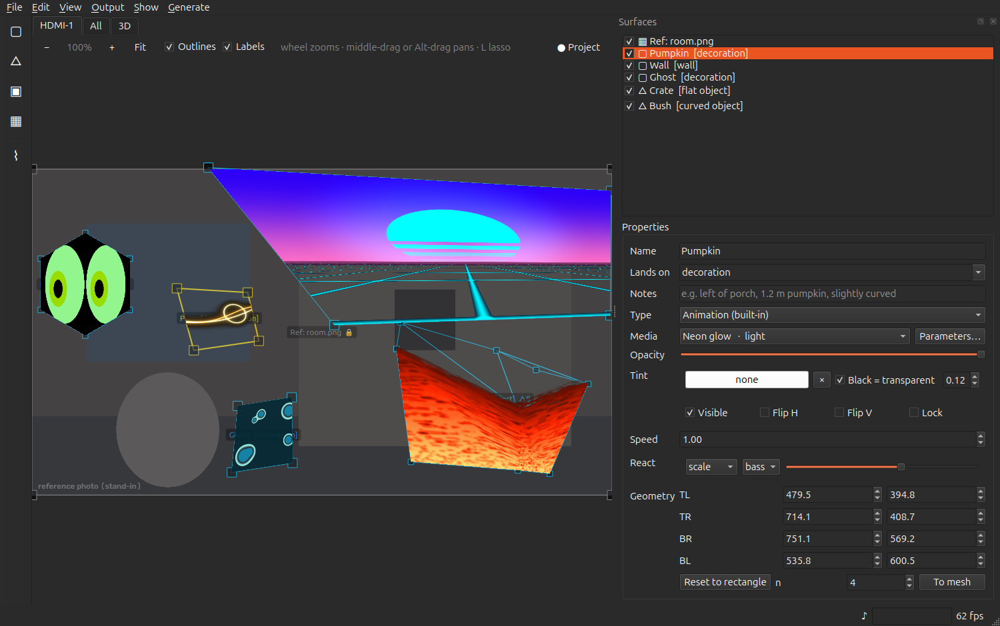
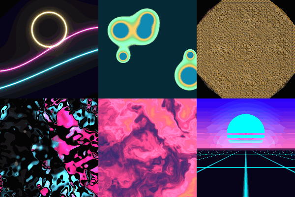
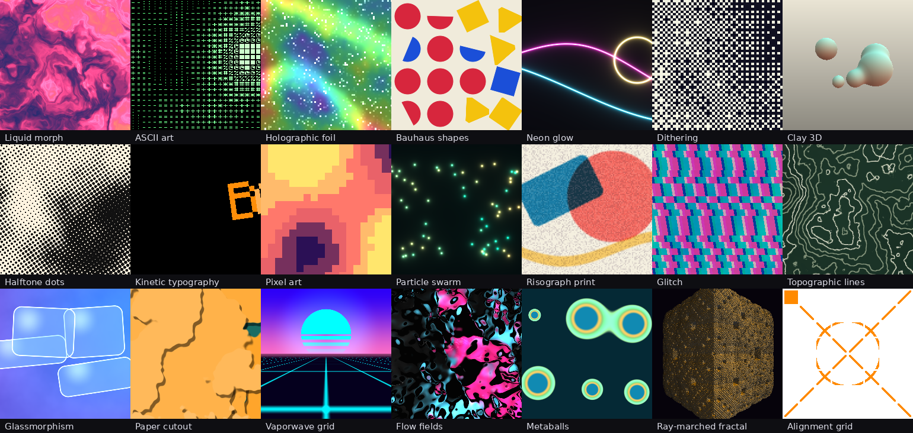
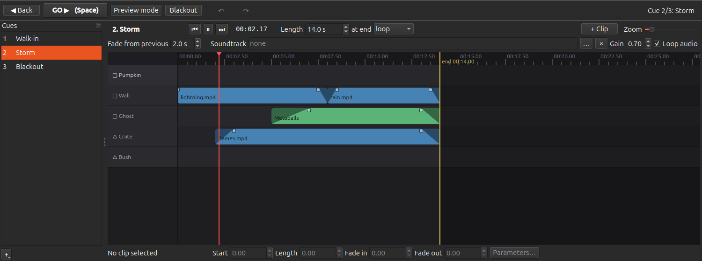
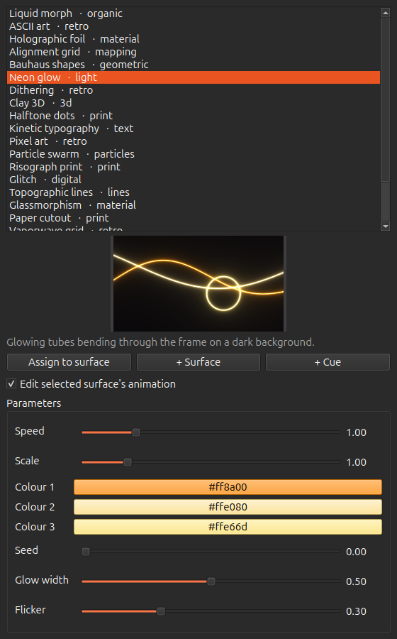
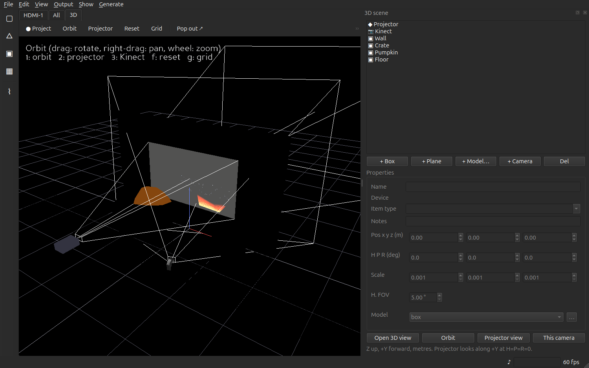

# promap

**Projection mapping editor and live show runner.** Pin animations, GIFs, videos and
images onto real objects with a projector, calibrate against a webcam or Kinect, then run
the result as a cued show. Python, Qt, OpenGL.



> **Platform.** promap has only been built and tested on **Linux** (Ubuntu 24.04, X11,
> Python 3.12, OpenGL 3.3 core). Nothing in it is Linux-specific on purpose, but macOS
> and Windows are untested and the Kinect and PortAudio setup notes below assume a Debian
> family distro.

## Features

- **Surfaces.** Quads with a GPU perspective warp, triangle meshes for anything that is not
  a flat rectangle, masks to blank spill, reference photos as an editor-only underlay, and
  a lasso tool that traces a prop into a mesh.
- **Media of every kind.** Images, animated GIF / WebP, video (with its own audio), and
  twenty built-in GLSL animations with live parameters. Per-surface tint, opacity, luma key,
  flips, speed and audio-reactive scale / opacity / gain.
- **Cues as timelines.** Each cue is a sequence of clips per surface with fades, a length,
  and a choice of loop / next / stop at the end. GO, Back, blackout, preview mode, a
  soundtrack per cue, and undo across everything.
- **Camera calibration.** Gray-code structured light from a USB webcam gives a
  projector-to-camera map; a photometric scan separates direct light, bounce, colour,
  depth and shadow; blob and edge detection turns props into surfaces.
- **Kinect v1 and v2.** Depth-based prop detection, plane finding, a live person mask or
  spotlight, MediaPipe skeleton tracking, and a point cloud in the 3D view.
- **3D scene.** A Panda3D simulation of the projector, cameras and props that shows the
  live output landing on the geometry, from any angle or through any lens.
- **Generate with ComfyUI.** Turn a surface's crop of the reference photo into a prompt for
  an image-to-video model and bring the clip back as media.
- **Hardware library.** Projectors, cameras and depth sensors with their optics, kept
  outside any project.

## Built-in animations

Every effect is a fragment shader with speed, scale, three colours, a seed and one or two
effect-specific knobs. They live in a surface, a cue or a project file as a string such as
`gen:neon_glow?speed=2&color1=ff00aa`.





## More of the editor

| Cue editor | Animations window |
|---|---|
|  |  |



## Install

```bash
uv venv --python 3.12 .venv
uv pip install -e ".[dev]"
.venv/bin/python examples/make_demo_media.py   # generates examples/media/*
```

Audio needs PortAudio (`sudo apt install libportaudio2`); without it the app runs silently
and says so in the status bar. Kinect drivers are covered under *Kinect* below.

## Run

```bash
.venv/bin/promap examples/demo.promap                 # editor; press Project (F5) to go live
.venv/bin/promap show.promap --output HDMI-1 --cue 1  # straight into the show, output open
.venv/bin/python -m pytest                            # tests (GPU tests skip without GL)
```

## Workflow

1. **Output → Set output size** to the projector's resolution (default 1920x1080),
   then press **● Project** (F5, top right of the viewer, also under Output). Nothing reaches
   the projector until you do; the button turns into **■ Live on <screen>** and pressing it
   again, or Esc in the output window, takes it down. It uses the screen saved in the
   project, else the screen the editor is not on; **Output → Open on screen** picks another.
2. **Output → Test pattern (T)** projects a labelled grid with every surface outlined,
   for focusing the lens and seeing where quads land on the props.
3. The tool palette down the left of the canvas adds things to the scene: **▢ Media**
   adds a surface (a quad), **△** a triangle, **▣** a mask, **▦** a reference photo,
   **⌇** the lasso. Every new surface starts out showing an **alignment grid** (a built-in
   animation: square cells, border, diagonals, centre ring, a marked corner, see-through
   between the lines) so keystone, stretch and flips are obvious while you drag its corners
   in the canvas until it hugs the object; then give it real media. Drag inside to move the
   whole quad. Arrow keys nudge the active corner (Tab cycles corners, Shift = 10 px steps,
   Shift-drag snaps to 10 px). **▣ Mask** adds a black quad to blank out spill (a window, a
   doorway). **Outlines** and **Labels** in the strip above the canvas (H, Shift+H, also
   under View) hide the corner handles and name tags so the media shows bare, the way the
   projector sees it.
4. Pick the surface's **Type**: image, video, animated image (GIF / WebP), a built-in
   animation, or **Mask** (a black cut-out; its media is kept for when it becomes a surface
   again). The tick beside each surface in the list hides and shows it on the output. The
   picker and the options below follow the type: Loop and Speed only for things that move,
   Video audio only for video, and for an animation a drop-down of effects plus
   **Parameters…**, which opens the Animations window on it with live edits. Surfaces are
   drawn in list order. Right-click a surface, in the list or in the canvas, for Duplicate,
   Delete, Bring to front / Move up / Move down / Send to back, Lock, Hidden and Mask.
5. **Cues**: set each surface's media the way a moment of the show should look, then
   **+ → Cue from editor** in the Cues window. A cue is a sequence of clips per surface with
   fades (see *Cues as sequences*); a crossfade length and an optional hold time for
   auto-advance sit on the cue.
6. **GO (Space)** / **Back (Backspace)** step through cues. **Preview mode** drops
   back to the editor's own assignments. **B** blackout. **Esc** in the canvas clears
   anything that hides the surfaces: a blackout, a calibration or scan in progress, the
   Camera window's white wash. A red banner at the top of the canvas names whichever of
   those is active, and a cue that assigns no media.

Project files are JSON (`.promap`); media paths are stored relative to the project
file so a show folder can be copied whole.

### Surface details

- **Reference photos.** **▦** loads a photo of the space (ideally shot from the projector's
  lens position) as a half-transparent layer under everything in the editor only; it never
  reaches the projector. Line it up with the projected test pattern, then tick **Lock**.
- **Lands on / notes.** Each surface and 3D prop records what it lands on (wall, curved
  object, decoration, ...). Informational today; the hook for per-type warping later.
- **Tint.** A colour multiplier per surface (white = unchanged): recolour a clip per surface,
  or per cue, without regenerating media.
- **Black = transparent.** A per-surface luma key: pixels darker than the threshold (0..1,
  default 0.12, soft edge just above it) let the layers underneath show through, so a clip
  on a black background composites over another surface instead of painting black on it.
- **Undo / redo.** Every change to the project document is undoable: **Ctrl+Z** /
  **Ctrl+Shift+Z** (or Ctrl+Y). A drag is one step however long it lasts; slider edits
  within 0.4 s of each other merge; camera-driven updates never enter the history. Up to
  200 steps are kept; loading a project clears them.
- **Lasso tool (L).** Drag freehand round an object, or click out the corners, then
  double-click or Enter to close (Esc cancels). The outline is simplified and triangulated
  into a mesh surface named `Lasso n`. The quick way to trace a prop by eye when the camera
  is not set up.

### Viewer tabs, panels and windows

Above the viewer: one tab per output screen, **All** (every output in one view) and
**3D**. The strip under the tabs holds the view's own controls: zoom −/+/Fit on a screen
tab (Ctrl+-, Ctrl++, Ctrl+0), Orbit / Projector / Reset / Grid / Pop out on the 3D tab.

The side panel (Surfaces / 3D scene) is a dock: drag it out by its title bar and it
becomes its own window; **View → Panels** brings closed ones back and **Reset panel
layout** restores everything. Camera (Ctrl+Shift+C), Animations (Ctrl+Shift+A) and Cues
(Ctrl+Shift+U) are separate windows under **View**, so any of them can sit on a second
screen. Window positions, and which were open, are remembered between runs.

## Triangle meshes

A quad (**▢**) is the right primitive for a flat rectangular face: four handles and a
perspective-correct warp. Everything else is a **mesh**: triangles sharing vertices, built
like game geometry, all showing one piece of media (the mesh *is* the group).

- `+ Tri` adds one triangle. Click an edge of the selected mesh (it turns green) and press
  **A**, or double-click the edge, to grow a new triangle off it. The new triangle continues
  the media seamlessly across the shared edge. With no edge picked, **A** drops a loose one.
- Drag a vertex onto another vertex of the same mesh and they **weld**: two loose triangles
  become one square. *Weld* in the panel merges anything already coincident.
- Click inside a triangle to make it active: **Delete** removes it, *Detach* splits it off
  into its own surface, *Merge ▲* folds the selected mesh into the mesh above it in the list.
- *Subdivide* splits every triangle into four, for props that are not flat.
- Texture coordinates: *Fit UVs* stretches the media over the mesh's bounding box. **U**
  (or *UV view*) shows the media flat and lets you drag the vertices in texture space.
  The active vertex's X, Y, U, V are also editable as numbers.
- *To mesh* turns a quad into an n×n grid whose texture coordinates come from the quad's
  homography, so it keeps the perspective warp to within one cell; *To quad* goes back
  (bounding box). n=1 is the plain two-triangle square, which has the classic diagonal
  seam on a keystoned shape, so use 4 or more for anything not square-on.

Inside a triangle the GPU interpolates texture coordinates linearly (an *affine* map),
which is exact for a flat-on triangle and a close approximation once a shape is
subdivided. The quad path stays projective, so convert only when you need the cuts.

## Camera (webcam on the projector)

The **Camera** window (View → Camera window, Ctrl+Shift+C) lists the USB cameras that deliver frames,
shows a live preview and does three jobs:

1. **Calibrate.** With the output window open on the projector and the room dimmed, it
   projects a Gray-code stripe sequence (about 46 patterns, a few seconds) while the camera
   watches, and decodes, for every camera pixel the projector lights, which projector pixel
   lit it. It stores a homography (one plane: the wall) in the project plus the dense
   per-pixel map in `<project>.calib.npz`, and outlines the projector's footprint on the
   preview. "lit N%" is how much of the camera view the projector reaches; "plane fit N%"
   is how much of that lies on one plane (props in front of the wall lower it, which is
   fine: the dense map covers them). *Settle* is the wait per pattern; raise it if the
   camera lags. A run whose camera stops delivering frames aborts itself after six
   seconds and puts the surfaces back; *Cancel* or Esc does the same at any time.
2. **Reference from camera.** Warps a camera frame into projector space and adds it as a
   reference image that is already aligned, so you can draw quads on the real props.
3. **Objects → geometry.** *Detect objects* finds blobs in the camera image (inside the
   footprint by default): *bright* for props under *Show white*, *dark* for dark props
   against the lit wall, *diff* against a stored background (set it with the scene empty,
   then place the prop), *edges* for outlines. *Simplify* controls how many vertices an
   outline keeps. *Create surfaces* maps each outline through the calibration and
   triangulates it into a mesh surface in projector pixels; pick its media and it is mapped.

4. **Scene scan** (a second, photometric calibration). With the geometry known, the
   projector becomes a controlled light: *Scan scene* projects black, white, red, green,
   blue and a fine stripe pair (seven frames, a few seconds, scene still) and turns the
   camera's response into per-pixel cues you can view one at a time:
   - *albedo*: how much projector light comes back (dark props vs the wall);
   - *color*: the surface's own colour under red/green/blue light, room light removed;
   - *direct*: Nayar's high-frequency separation. Under fine stripes, max minus min is light
     straight from the projector, the minimum is bounce. Edges sharpen, corners stop glowing;
   - *depth*: the camera sits beside the lens, so anything off the wall maps away from the
     wall's homography; the residual is a parallax depth cue (red = in front, blue = away);
   - *shadow*: inside the footprint but never lit: cast shadows and light-swallowing surfaces.
   *Segment* clusters the weighted cues into N classes and outlines every connected region
   (the largest, normally the wall, is dropped); the sliders set how much each cue counts.
   *Create surfaces* then works exactly as for detections. The scan is saved as
   `<project>.scan.npz`. One shot, not real time: rescan when props move.

One camera pixel covers several projector pixels (about 4 to 9 with a 640x480 camera on a
1920x1080 output), so the finest stripes are not resolvable; the decoder detects which bits
the camera can resolve and fills the rest, and all thresholds scale with that ratio. Use
1280x720 or 1920x1080 on the camera for tighter outlines.

Set `PROMAP_NO_CAMERA_SCAN=1` to skip the camera probe altogether (headless runs, tests: the
probe reads a frame from every video node, which blinks a laptop's webcam LED). The test
suite sets it for itself.

## Kinect

**Kinect v2** (Xbox One, time-of-flight depth, 512x424) is driven by libfreenect2, which is
not packaged. `scripts/setup_kinect.sh --check` reports what is missing; the full script
builds the driver into `~/.local/freenect2` and installs the `freenect2` Python binding
into the venv with an rpath, so nothing needs setting at launch. Two steps need sudo and
are printed by the check: the build packages (`libusb-1.0-0-dev libturbojpeg0-dev
libglfw3-dev`) and the udev rule that lets a user open the device.

**It must be on USB 3.** On a USB 2 link the sensor enumerates with a different descriptor
(microphone array only; `bcdUSB 2.10`, interfaces: vendor + two audio) and libfreenect2
fails with `LIBUSB_ERROR_BUSY` on interface 1. The check script prints the link speed; it
has to read 5000 or more.

In the Camera window the Kinect appears as a device, "Kinect v2 (colour on depth pixels)".
It delivers the colour image registered onto the depth pixels, so calibrating through it
maps depth pixels straight to projector pixels and everything else in the dock (scan,
detection, create surfaces) works unchanged. Extras with a Kinect: the *live depth* view,
and the *depth* detection mode (anything nearer than the stored depth background, or
nearer than 4.5 m without one), which does not care about colour or lighting at all.
`promap/camera/kinect.py` also back-projects depth to metric points for the 3D scene.

**Kinect v1** (Xbox 360, structured light, 640x480, the cable with the orange USB plug) is
the easy one: `sudo apt install freenect libfreenect0.5t64 libfreenect-bin` installs the
driver and its udev rule, it works over USB 2, and promap talks to it through libfreenect's
synchronous C API with ctypes (`promap/camera/kinect1.py`), nothing to compile. It shows up
in the Camera window as "Kinect v1 (depth on colour pixels)": depth comes registered onto the
RGB image, so the same calibrate / scan / detect flow applies, with *live depth* and the
*depth* detection mode (its *nearer by* / *max range* controls appear when the mode is
selected, and the cut-out is shaded on the preview). Depth mode cuts out what stands at
least *nearer by* in front of the wall: with no stored background the wall is a plane
fitted to the depth inside the projector footprint (so calibrate first, or untick *Only
inside projector footprint* and expect the whole room to be judged against one plane);
*Set background* with the scene empty replaces the plane with the real background. Depth
is median-filtered over three frames to stop the outlines flickering. **Show in 3D** streams the depth
camera's coloured point cloud into the 3D view (F3), hung on the scene's first camera node
(one named "Kinect" is created on top of the projector if there is none); move that node
to where the sensor really sits and the cloud lands in the room. Each detection mode
has a one-line explanation under the mode box. Needs its 12 V brick: if `lsusb` shows only "Xbox NUI Motor", the
camera board has no power; unplug everything, plug the brick first, then USB. The kernel's
`gspca_kinect` module also claims the camera as a plain webcam; libfreenect detaches it,
and promap never probes that node, but if opening ever stalls, blacklist it once:
`echo "blacklist gspca_kinect" | sudo tee /etc/modprobe.d/kinect.conf`. Keep it out
of the projector's beam where you can, and expect holes on glossy or very dark surfaces
and under 0.8 m.

### Planes, people and skeletons (depth camera)

The last group in the Camera window needs a running Kinect:

- **Find planes** fits the flat surfaces in the depth image (walls, floor, slopes, table
  tops, box faces): per-pixel normals, a vote over normal direction and offset, least-squares
  refinement, largest connected patch, repeat. The list shows each plane's kind and size.
  **→ 3D props** adds them to the 3D scene as `plane` props placed relative to the Kinect
  node (so set that node's real pose first); **→ surfaces** maps each outline through the
  calibration into a mesh surface in projector pixels.
- **People** assumes the scene the Kinect looks at does not move. Press *Set background*
  with nobody there; afterwards anything at least *nearer by* closer than that background is
  a person. *mask* keeps a live black surface over them so the projection never lands on
  skin; *spotlight* does the opposite, a live media surface that follows them (pick its media
  in the Surfaces list, it is called "People (live)"). *margin* grows the outline for safety.
  Updated about twelve times a second; the surface empties when nobody is there.
- **Skeleton tracking** runs MediaPipe's pose landmarker on the colour image (33 joints per
  person, about 15 ms on the CPU), draws it on the preview and, with depth, as a 3D stick
  figure under the Kinect node in the 3D view. The 5 MB model downloads once into
  `~/.local/share/promap/models/`. Joint positions are the hook for triggering cues or
  steering media later.

## Scripted animations (the Animations window)

Twenty animations (plus the alignment grid, a mapping aid) are code, not files: GLSL fragment shaders drawn on the GPU every frame
with parameters you can change while they run. The **Animations** window (View → Animations window, Ctrl+Shift+A) lists them with a live preview and a parameter editor generated from each one's
spec: speed, scale, three colours, a seed, and one or two effect-specific knobs (glow width,
pixel size, text, ...). *Assign to surface* puts the animation on the selected surface, in
the editor or in the running cue; *+ Surface* adds a new quad with it; *+ Cue* snapshots the
editor into a cue. With *Edit selected surface's animation* ticked, selecting a surface that
shows an animation loads its parameters, and every slider move applies to the running
layer without restarting it.

An animation is stored as a media string, `gen:neon_glow?speed=2&color1=ff00aa`, so it goes
anywhere a file path goes (surfaces, cues, project files) and only the values that differ
from the defaults are written. The effects: liquid morph, ASCII art, holographic foil,
Bauhaus shapes, neon glow, dithering, clay 3D, halftone dots, kinetic typography, pixel art,
particle swarm, risograph print, glitch, topographic lines, glassmorphism, paper cutout,
vaporwave grid, flow fields, metaballs, ray-marched fractal. Adding one is a GLSL function
in `promap/media/gen_shaders.py` plus a spec line in `promap/media/generative.py`; the test
suite compiles every effect and checks that it moves.

## Cues as sequences (the cue editor)

A cue is a sequence, edited like a video timeline in **View → Cues window** (Ctrl+Shift+U):
one track per media surface, clips along a time axis, a ruler with a playhead. A clip is one
piece of media (image, video, GIF, built-in animation, or a deliberate dark stretch) on one
surface from a start time for a length, with its own fade-in and fade-out. The cue has one
length (the yellow end marker: drag it, type it, or drag a clip past it) and one choice of
what happens there: **loop**, **next cue** (the show advances by itself) or **stop** (park
on the last frame until GO). Firing a cue (GO, a pad later) fades the previous cue's
layers out over the new cue's **Fade**.

The editor plays live on the canvas and the output once you touch its transport: dragging
the ruler fires the cue paused and scrubs it; Space plays. Selecting a cue only shows it. Drag a clip to move it (onto another
track too); drag its ends to trim; drag the small squares on its top corners to set the
fades; double-click an empty track to drop the surface's editor media there; right-click a
clip for its media (animation list, file, editor media, dark), split at the playhead,
duplicate, delete; right-click a track to add; right-click anywhere for cue length and
the at-end choice. The inspector row edits the selected clip's numbers, and **Parameters…** opens the
Animations window on an animation clip. Keys: Space, Home, ←/→ nudge, S split, Delete.
Ctrl+wheel zooms. The tracks fill the window; drag anything to the right edge and the
sequence scrolls and grows under it, the playhead keeps itself on screen while playing,
and the track names stay pinned on the left. Ctrl+C / Ctrl+X / Ctrl+V copy, cut and paste a clip, at the playhead on its
own track, or **Paste here** from a track's right-click menu; the clipboard carries it
between cues and projects. Undo and redo (↶ ↷ in the toolbar, Ctrl+Z / Ctrl+Shift+Z) cover
every edit here, and an undo while a cue is live keeps that cue playing.

Back, GO, Preview mode and Blackout sit in a toolbar across the top of the window, with
the show status. The narrow **Cues** dock beside the editor is just the names: select one
and the editor shows it
(selecting never fires a cue; GO, Fire, or the transport do). **+** adds a cue, empty or
from each surface's current media (one full-length clip per surface). Right-click a cue
for the rest: fire, rename, duplicate, delete, move up / down, update from editor, load
into editor (its clips under the playhead go back onto the surfaces). The cue's own
settings sit above the tracks: length and the at-end choice, the fade from the previous
cue, and the soundtrack with its gain and loop. Old projects load unchanged: a per-surface
media map becomes full-length clips.

## Demo media

`examples/make_demo_media.py` generates every clip procedurally and takes the same knobs,
so variants are one command away:

```bash
.venv/bin/python examples/make_demo_media.py --list
.venv/bin/python examples/make_demo_media.py flames --color "#ff4000" --color2 "#ffe080" --speed 1.5
.venv/bin/python examples/make_demo_media.py rain spiral --seconds 6 --size 512x512 --out /tmp/clips
.venv/bin/python examples/make_demo_media.py eyes --color 0,255,80 --name eyes_green
```

Knobs: `--color`, `--color2`, `--speed`, `--seconds`, `--fps`, `--size WxH`, `--seed`,
`--density`, `--name`. Clips: `flames`, `rain`, `eyes`, `lightning`, `spiral`, `drips`,
`fog`, plus the originals `pulse`, `bars`, `ghost`, `room`, `drone`. Colour and speed can
also be changed live per surface (Tint, Speed).

## Audio

- **Soundtrack per cue**: the cue table's *Audio* column (or the *Audio…* button) sets a
  file per cue with its own gain. The same file across consecutive cues keeps playing;
  a different file crossfades over the cue's fade time (or `audio_fade` in the JSON).
  Preview mode fades the soundtrack out.
- **Video audio**: tick *Video audio* on a surface and its video's own track plays with the
  layer (looping with it).
- **Audio-reactive**: the *React* row maps a band (rms / bass / mid / high) onto opacity,
  scale (grows about the centre) or gain (brightness). Levels auto-normalise, so quiet and
  loud tracks both drive the full range; `♪` in the status bar is the live level.
- `M` mutes, Show → Audio volume… sets the master. Needs PortAudio (`libportaudio2`);
  without an output device the app runs silently and says so in the status bar.

## Generating media with ComfyUI

**Generate → Generate media with ComfyUI… (Ctrl+G)** turns a surface into a prompt for a
video model and brings the clip back as media:

1. *Source*: a **rectified crop** of the surface's quad cut from the reference photo (the
   prop, flattened; a clip generated from it maps straight back onto the prop through the
   same quad), the **full reference photo** (wall-wide effects), or **none** (text to video).
2. *Template*: any ComfyUI workflow exported in **API format** (Settings → Dev mode →
   *Save (API format)*), dropped in `~/.local/share/promap/workflows/`. promap fills nodes
   by **title**: `promap_image`, `promap_prompt`, `promap_negative`, `promap_seed`,
   `promap_frames`, `promap_width`, `promap_height`, `promap_fps`, `promap_prefix`
   (append `:input_name` to force a specific input, e.g. `promap_frames:length`). Two
   examples (`i2v_example`, `t2v_example`, Wan 2.2 5B) are installed on first use; they
   need the named model files, so treat them as a starting point and re-export your own.
3. Prompt, negative, seed, frames, fps, size (auto-sized from the quad). Generate runs in
   the background with progress; results land in `media/generated/` next to the project
   and can be **assigned to the surface** or **added as a new cue**.

**Setting up ComfyUI** (needs a machine with an Nvidia GPU; 12 GB+ VRAM is comfortable
for 480p image-to-video, smaller models exist):

```bash
git clone https://github.com/comfyanonymous/ComfyUI && cd ComfyUI
python -m venv .venv && . .venv/bin/activate
pip install torch --index-url https://download.pytorch.org/whl/cu124 && pip install -r requirements.txt
git clone https://github.com/ltdrdata/ComfyUI-Manager custom_nodes/ComfyUI-Manager
python main.py --listen 0.0.0.0 --port 8188
```

Then in promap **Edit → Preferences… → Generation** set the URL (`http://<gpu-box>:8188`) and press
*Test connection*. Model names change monthly: in ComfyUI's manager, pick a current
image-to-video model, build the workflow, title the nodes, export API format.
Generated audio (ambience, SFX) will use the same template mechanism later.

## Hardware library

**Edit → Preferences… → Hardware** (Ctrl+,) keeps your projectors, cameras and depth sensors with
their parameters (resolution, throw ratio or field of view, depth range, notes) outside
any project, in `~/.local/share/promap/hardware.json` (or `$PROMAP_HARDWARE`). It is
seeded with Kinect v2, Kinect v1 and a generic 1080p projector. *Use as this project's
projector* sets the output size and the 3D projector's lens from the device; *Assign to
selected 3D camera* does the same for a camera node.

## 3D scene view (Panda3D)

The **3D** tab above the viewer (or F3) shows the Panda3D scene in place of the 2D canvas;
F3 again closes it. **Pop out** in the strip above the scene moves it to a separate window
(for a second screen). The
**3D scene** dock (tabbed behind Surfaces) edits the projector's pose and horizontal field of view (the
throw ratio is shown next to it), extra cameras such as a Kinect, and props: box, plane,
or any model file (obj / gltf / stl / egg via Assimp). Units are metres, Z up, +Y forward.

The live 2D output is projected from the projector's frustum onto the props, so you can
orbit the scene, look **through the projector** (what the lens sees) or **through a
camera** offset from it (what the Kinect would see). Keys in the 3D tab (click it first):
`1` orbit, `2` projector, `3`..`9` cameras, `f` reset, `g` grid; drag to rotate, right-drag
to pan, wheel to zoom. Orbit and projector views are also buttons in the strip above it.

## Architecture

```
promap/
  model/geometry.py    homography (projective warp) maths, hit-testing
  model/mesh.py        triangle meshes: shared vertices, UVs, extrude / weld / subdivide
  model/project.py     Project / Surface / Cue / Clip dataclasses, JSON I/O
  model/scene.py       projector / cameras / props for the 3D simulation
  camera/capture.py    USB camera discovery + threaded grabber
  camera/graycode.py   Gray-code structured light: patterns, decode, Calibration (H + dense map)
  camera/detect.py     blobs -> simplified contours -> ear-clipped triangle meshes
  camera/kinect.py     Kinect v2 (libfreenect2); kinect1.py: Kinect v1 (libfreenect, ctypes)
  media/sources.py     frame sources: image, GIF/WebP, video (OpenCV), test pattern
  media/generative.py  scripted animation specs + gen: media strings; gen_shaders.py: the GLSL
  show/engine.py       cues -> layers with crossfades -> RenderItems
  render/renderer.py   moderngl: textured quads with GPU perspective warp, masks
  render/gen.py        draws scripted animations into textures
  scene/view3d.py      Panda3D window: frustums, props, output projected onto them
  ui/                  Qt: state (signals), canvas, output window, panels, cue editor, main window
```

The warp is done by handing the GPU homogeneous corner coordinates, so the
rasteriser's own perspective divide does the keystone correction. No per-pixel
work in Python.

## Roadmap

- Bezier / mesh warping for curved props; per-surface soft edge masks.
- MIDI / OSC triggers, scheduled start, cues fired from skeleton joints.
- 3D-authored output: texture the props in the 3D scene and render the output *from*
  the projector's lens, instead of hand-dragging 2D quads.
- Depth-reactive animations from the Kinect point cloud.
- Known artefact: Panda's projective texturing also paints props *behind* the projector
  (mirrored), as fixed-function projection has no front/back test.

## License

MIT. See `LICENSE`.
